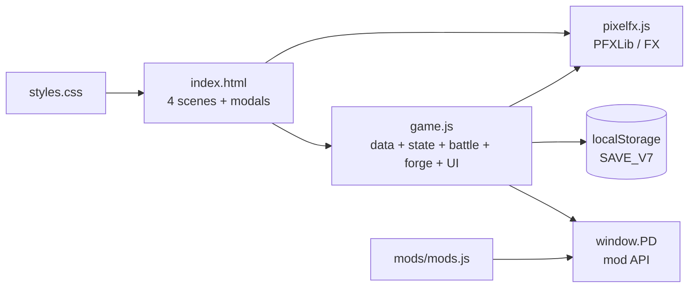

# PixelDungeon_simple — Project Analysis & Plan / Análisis del Proyecto y Plan

> **Bilingual document / Documento bilingüe:** Every section is written in **Spanish (ES)** first and **English (EN)** second. / Cada sección está escrita primero en **español (ES)** y después en **inglés (EN)**.
> Branch / Rama: `arena/90e76ced-pixeldungeon-simple` · Base commit: `28f1fe25c0e7da93f289eae190262571d287afc6` (`main`) · Date / Fecha: 2026-11-22

---

## Table of Contents / Índice

1. [Executive Summary / Resumen Ejecutivo](#1-executive-summary--resumen-ejecutivo)
2. [What This Project Is / Qué es este proyecto](#2-what-this-project-is--qué-es-este-proyecto)
3. [Repository Map / Mapa del Repositorio](#3-repository-map--mapa-del-repositorio)
4. [Architecture / Arquitectura](#4-architecture--arquitectura)
5. [Game Systems Inventory / Inventario de Sistemas](#5-game-systems-inventory--inventario-de-sistemas-de-juego)
6. [Data, Save & Balance / Datos, Guardado y Balance](#6-data-save--balance--datos-guardado-y-balance)
7. [Strengths / Fortalezas](#7-strengths--fortalezas)
8. [Weaknesses, Tech Debt & Risks / Debilidades, Deuda Técnica y Riesgos](#8-weaknesses-tech-debt--risks--debilidades-deuda-técnica-y-riesgos)
9. [Vision & Goals / Visión y Objetivos](#9-vision--goals--visión-y-objetivos)
10. [Roadmap & Plan / Hoja de Ruta y Plan](#10-roadmap--plan--hoja-de-ruta-y-plan)
11. [Prioritization / Priorización](#11-prioritization--priorización)
12. [Suggested Timeline / Cronograma Sugerido](#12-suggested-timeline--cronograma-sugerido)
13. [Testing & QA / Pruebas y Calidad](#13-testing--qa--pruebas-y-calidad)
14. [Release & Operations / Lanzamiento y Operación](#14-release--operations--lanzamiento-y-operación)
15. [KPIs & Success Metrics / KPI y Métricas de Éxito](#15-kpis--success-metrics--kpi-y-métricas-de-éxito)
16. [Open Decisions / Decisiones Abiertas](#16-open-decisions--decisiones-abiertas)
17. [Appendix A — File Inventory / Apéndice A — Inventario de Archivos](#appendix-a--file-inventory--apéndice-a--inventario-de-archivos)
18. [Appendix B — Glossary / Apéndice B — Glosario](#appendix-b--glossary--apéndice-b--glosario)

---

## 1. Executive Summary / Resumen Ejecutivo

### ES — Resumen Ejecutivo

**PixelDungeon_simple** es un RPG idle / de crecimiento monótono para navegador, con estética pixel-art 16-bit, publicado en GitHub Pages. El jugador refuerza espada y armadura, derrota monstruos normales, élite y jefes por pisos, y progresa indefinidamente (jefes cada 10 pisos, "Señor del Abismo" cada 50). El bucle principal es: **entrar a mazmorra → ganar oro/llaves → abrir cofres → forjar/transcender equipo → subir de piso**.

El repositorio contiene **dos implementaciones del mismo juego**:

| Versión | Tecnología | Estado |
|---|---|---|
| **Web (principal)** | HTML + CSS + JS vanilla, Canvas, `localStorage` | Jugable, publicada, con ~19.000 líneas totales (JS/CSS/HTML). Es la fuente de verdad del producto. |
| **C++ (prototipo de consola)** | C++20, Visual Studio (`vcxproj`/`slnx`), Windows | Prototipo de consola con la misma lógica base (combate por turnos, forja, cofres, runas, habilidades). No está sincronizado con la versión web. |

**Conclusión del análisis:** el juego web ya es un producto completo y divertido, pero está construido como **un monolito**: `game.js` (~2.969 líneas, 1,4 MB con atlas base64 embebido), `pixelfx.js` (~12.470 líneas, 637 KB) y `index.html` cargan sin build, sin módulos, sin tests y sin CI. La versión C++ duplica lógica sin compartir datos ni balance. Los archivos `.bak` / `.original` (hasta 2 MB) están versionados por error. El idioma del juego y del código es coreano, sin i18n.

**El plan propuesto** (ver §10) tiene 6 fases en ~12 semanas: **(0)** higiene del repo, **(1)** modularización web sin cambiar gameplay, **(2)** calidad (tests, save versionado, balance como datos), **(3)** i18n EN/ES/KO + accesibilidad, **(4)** decisión C++ (archivar o sincronizar) + contenido nuevo, **(5)** lanzamiento y crecimiento. Cada fase tiene criterios de aceptación medibles.

### EN — Executive Summary

**PixelDungeon_simple** is a browser-based idle / incremental RPG with a 16-bit pixel-art aesthetic, published on GitHub Pages. The player upgrades sword and armor, defeats normal, elite, and boss monsters floor by floor, and progresses indefinitely (bosses every 10 floors, an "Abyss Lord" every 50). The core loop is: **enter dungeon → earn gold/keys → open chests → forge/transcend gear → climb floors**.

The repository contains **two implementations of the same game**:

| Version | Technology | Status |
|---|---|---|
| **Web (primary)** | HTML + CSS + vanilla JS, Canvas, `localStorage` | Playable, published, ~19,000 total lines (JS/CSS/HTML). This is the product source of truth. |
| **C++ (console prototype)** | C++20, Visual Studio (`vcxproj`/`slnx`), Windows | Console prototype with the same base logic (turn-based combat, forging, chests, runes, skills). Not synced with the web version. |

**Analysis conclusion:** the web game is already a complete, fun product, but it is built as a **monolith**: `game.js` (~2,969 lines, 1.4 MB with an embedded base64 atlas), `pixelfx.js` (~12,470 lines, 637 KB), and `index.html` load with no build step, no modules, no tests, and no CI. The C++ version duplicates logic without sharing data or balance. `.bak` / `.original` files (up to 2 MB) are accidentally versioned. Game and code language is Korean, with no i18n.

**The proposed plan** (see §10) has 6 phases over ~12 weeks: **(0)** repo hygiene, **(1)** web modularization without changing gameplay, **(2)** quality (tests, versioned saves, balance-as-data), **(3)** EN/ES/KO i18n + accessibility, **(4)** C++ decision (archive or sync) + new content, **(5)** launch and growth. Each phase has measurable acceptance criteria.

---

## 2. What This Project Is / Qué es este proyecto

### ES

- **Género:** RPG idle/incremental por turnos, 1 vs 1, con progresión infinita por pisos.
- **Plataforma:** navegador web (móvil y escritorio), sin instalación. URL pública: `https://jun-joyfully.github.io/PixelDungeon_simple/`
- **Público:** jugadores casuales de juegos idle coreanos; fans de pixel-art retro.
- **Monetización:** ninguna (juego gratuito, sin anuncios ni compras). El oro y las llaves son monedas internas.
- **Persistencia:** `localStorage` del navegador (`PIXEL_DUNGEON_VIBE_SAVE_V7`). Sin cuentas, sin nube, sin backend.
- **Atajos:** `Enter` = siguiente piso / empezar, `R` = repetir piso, `ESC` = volver al pueblo, `Espacio` = resolver en modo skip.

### EN

- **Genre:** turn-based idle/incremental RPG, 1 vs 1, with infinite floor progression.
- **Platform:** web browser (mobile and desktop), no install. Public URL: `https://jun-joyfully.github.io/PixelDungeon_simple/`
- **Audience:** casual players of Korean idle games; retro pixel-art fans.
- **Monetization:** none (free game, no ads or purchases). Gold and keys are internal currencies.
- **Persistence:** browser `localStorage` (`PIXEL_DUNGEON_VIBE_SAVE_V7`). No accounts, no cloud, no backend.
- **Shortcuts:** `Enter` = next floor / start, `R` = repeat floor, `ESC` = back to town, `Space` = resolve in skip mode.

---

## 3. Repository Map / Mapa del Repositorio

### ES

```
PixelDungeon_simple/
├── index.html            # Shell web: 4 escenas (title/menu/battle/forge/character) + modales
├── game.js               # Lógica del juego web (~2.969 líneas, 1,4 MB con atlas base64)
├── pixelfx.js            # Librería de efectos pixel-art (~12.470 líneas, 637 KB, PFXLib/FX)
├── styles.css            # Estilos 16-bit (~345 líneas, fuente Galmuri vía CDN)
├── mods/mods.js          # Loader de mods (stub de 3 líneas: PD.on('ready', ...))
├── assets/               # Capturas JPG (title/battle/character/forge) + hero_sheet.jpg
├── PixelDungeon_simple/  # Prototipo C++ de consola (19 .cpp/.h + .vcxproj)
├── PixelDungeon_simple.slnx
├── README.md             # Descripción en coreano + enlace al juego
├── index.html.bak / .original / game.js.original_bak  # ⚠️ Backups versionados (hasta 2 MB)
└── .gitignore            # Plantilla Visual Studio (no cubre *.bak/*.original)
```

### EN

```
PixelDungeon_simple/
├── index.html            # Web shell: 4 scenes (title/menu/battle/forge/character) + modals
├── game.js               # Web game logic (~2,969 lines, 1.4 MB with embedded base64 atlas)
├── pixelfx.js            # Pixel-art FX library (~12,470 lines, 637 KB, PFXLib/FX)
├── styles.css            # 16-bit styles (~345 lines, Galmuri font via CDN)
├── mods/mods.js          # Mod loader (3-line stub: PD.on('ready', ...))
├── assets/               # JPG screenshots (title/battle/character/forge) + hero_sheet.jpg
├── PixelDungeon_simple/  # C++ console prototype (19 .cpp/.h + .vcxproj)
├── PixelDungeon_simple.slnx
├── README.md             # Korean description + link to the game
├── index.html.bak / .original / game.js.original_bak  # ⚠️ Versioned backups (up to 2 MB)
└── .gitignore            # Visual Studio template (does not cover *.bak/*.original)
```

---

## 4. Architecture / Arquitectura

### ES

**Versión web (principal).** Sin framework ni bundler: tres `<script>` en orden (`pixelfx.js` → `game.js` → `mods/mods.js`) y un CSS. `game.js` es un único ámbito global con ~191 funciones: datos (tablas de habilidades, mascotas, disfraces, logros, jefes de raid, códice, reliquias, runas, monstruos, mundos), estado (`S` + `save()`/`load()`/`sanitize()`), combate (`startBattle`, `basicAttack`, `castSkill`, `skipResolve`, `victory`/`defeat`), forja (`enhanceTry`, `doRankUp`, `doInfuseRainbow`), cofres/gacha (`openOne`, `rollGrade`), renderizado Canvas (`drawMonster`, `drawPet`, `drawSwordIcon`, `drawRelicIcon`…) y UI por escenas/modales (`switchScene`, `openModal`, `renderMenu`, `renderForge`…). La API pública para mods es `window.PD` (`PD.on`, `PD.openModal`, `PD.mods`).

**Versión C++ (prototipo).** Arquitectura orientada a objetos clásica: `Character` (base) → `Player` / `Monster` → `NormalMonster` / `Boss`; `Equipment`/`Armor`; `Skill`/`SkillManager`; `Rune`/`RuneManager`; `ChestSystem`; `BattleSystem`; `Dungeon`; `Game` (bucle principal + menús de consola). Entrada en `main.cpp` (fija UTF-8 en consola Windows, `srand(time)`). Compila con Visual Studio (C++20, x64/x86, Debug/Release). **No comparte código ni datos con la versión web**: es una reimplementación paralela y más pequeña.

**Diagrama (web):**



### EN

**Web version (primary).** No framework or bundler: three `<script>` tags in order (`pixelfx.js` → `game.js` → `mods/mods.js`) and one CSS file. `game.js` is a single global scope with ~191 functions: data (skill, pet, costume, achievement, raid-boss, codex, relic, rune, monster, world tables), state (`S` + `save()`/`load()`/`sanitize()`), combat (`startBattle`, `basicAttack`, `castSkill`, `skipResolve`, `victory`/`defeat`), forging (`enhanceTry`, `doRankUp`, `doInfuseRainbow`), chests/gacha (`openOne`, `rollGrade`), Canvas rendering (`drawMonster`, `drawPet`, `drawSwordIcon`, `drawRelicIcon`…), and scene/modal UI (`switchScene`, `openModal`, `renderMenu`, `renderForge`…). The public mod API is `window.PD` (`PD.on`, `PD.openModal`, `PD.mods`).

**C++ version (prototype).** Classic OOP: `Character` (base) → `Player` / `Monster` → `NormalMonster` / `Boss`; `Equipment`/`Armor`; `Skill`/`SkillManager`; `Rune`/`RuneManager`; `ChestSystem`; `BattleSystem`; `Dungeon`; `Game` (main loop + console menus). Entry point in `main.cpp` (forces UTF-8 on Windows console, `srand(time)`). Builds with Visual Studio (C++20, x64/x86, Debug/Release). **It shares no code or data with the web version**: it is a parallel, smaller reimplementation.

**Diagram (web):** *(same as above / igual que arriba)*

---

## 5. Game Systems Inventory / Inventario de Sistemas

### ES

| Sistema | Web (`game.js`) | C++ | Notas |
|---|---|---|---|
| Combate por turnos 1v1 + velocidad 1x/2x/skip | ✅ | ✅ | Skip desbloqueado al piso 10 |
| Pisos infinitos, jefe c/10, élite c/5, Señor del Abismo c/50 | ✅ | Parcial (jefe c/10, élite c/5) | Web añade mundos (`WORLDS`, hoy 1 mundo) |
| Forja: +10, estrellas, transcender arcoíris, forja continua ×60 | ✅ | Solo +10 (1× y continua) | Web: `enhanceTry`, `stepUp`, `doInfuseRainbow` |
| Cofres/gacha (espada, armadura, habilidad) + nivel de cofre 1–10 | ✅ | ✅ (espada/habilidad/armadura) | Web: probabilidades por nivel, EXP de cofre |
| Habilidades (28 en web) + 4 equipadas + auto/manual + re-roll de opciones | ✅ | ✅ (auto/manual) | Web añade opciones C–SS y re-roll con oro |
| Runas: 3 tipos × 9 tiers, síntesis, sets | ✅ | ✅ (3 tipos, sets por grado) | Web llega a "arcoíris ★5" |
| Entrenamiento (7 stats, hasta Lv.1000) | ✅ | ❌ | Solo web |
| Códex + grabado + recompensas por % | ✅ | ❌ | Solo web |
| Reliquias (excavar, hasta Lv.100 c/u) | ✅ | ❌ | Solo web |
| Mascotas (8 tipos, eclosión, nivel) | ✅ | ❌ | Solo web |
| Disfraces (skins/auras/círculos) | ✅ | ❌ | Solo web, bonus de stats |
| Logros (6 líneas × 5 tiers) | ✅ | ❌ | Solo web |
| Raids dimensionales (3 jefes, límite 15 turnos) | ✅ | ❌ | Solo web |
| Equipo de jefe (espada/armadura exclusivas) | ✅ | ✅ | Drop en jefes |
| Mods (`PD`) | ✅ (stub) | ❌ | Solo web |
| Guardado | `localStorage` | Sin persistencia | C++ pierde progreso al cerrar |

### EN

| System | Web (`game.js`) | C++ | Notes |
|---|---|---|---|
| Turn-based 1v1 combat + 1x/2x/skip speed | ✅ | ✅ | Skip unlocked at floor 10 |
| Infinite floors, boss every 10, elite every 5, Abyss Lord every 50 | ✅ | Partial (boss every 10, elite every 5) | Web adds worlds (`WORLDS`, currently 1 world) |
| Forge: +10, stars, rainbow transcendence, ×60 batch forge | ✅ | +10 only (single + batch) | Web: `enhanceTry`, `stepUp`, `doInfuseRainbow` |
| Chests/gacha (sword, armor, skill) + chest level 1–10 | ✅ | ✅ (sword/skill/armor) | Web: per-level odds, chest EXP |
| Skills (28 in web) + 4 equipped + auto/manual + option re-roll | ✅ | ✅ (auto/manual) | Web adds C–SS options and gold re-roll |
| Runes: 3 types × 9 tiers, synthesis, sets | ✅ | ✅ (3 types, grade sets) | Web reaches "rainbow ★5" |
| Training (7 stats, up to Lv.1000) | ✅ | ❌ | Web only |
| Codex + engraving + % rewards | ✅ | ❌ | Web only |
| Relics (excavate, up to Lv.100 each) | ✅ | ❌ | Web only |
| Pets (8 types, hatching, levels) | ✅ | ❌ | Web only |
| Costumes (skins/auras/circles) | ✅ | ❌ | Web only, stat bonuses |
| Achievements (6 tracks × 5 tiers) | ✅ | ❌ | Web only |
| Dimensional raids (3 bosses, 15-turn limit) | ✅ | ❌ | Web only |
| Boss gear (exclusive sword/armor) | ✅ | ✅ | Drops from bosses |
| Mods (`PD`) | ✅ (stub) | ❌ | Web only |
| Save | `localStorage` | No persistence | C++ loses progress on exit |

---

## 6. Data, Save & Balance / Datos, Guardado y Balance

### ES

- **Datos:** tablas constantes al inicio de `game.js` (`SKILLS`, `PET_TYPES`, `COSTUMES`, `ACHIEVEMENTS`, `RAID_BOSSES`, `CODEX`, `RELICS`, `RUNE_*`, `NORMAL/ELITE/BOSS_MONSTERS`, `WORLDS`, `TRAIN`, `CHEST_LV`, `EQUIP`…). Bien separadas de la lógica en la práctica, pero en el mismo archivo.
- **Guardado:** un único objeto `S` serializado a `localStorage` (`SAVE_KEY = 'PIXEL_DUNGEON_VIBE_SAVE_V7'`). `sanitize()` valida/migra campos al cargar. Sin esquema versionado formal ni migración entre versiones de save (el sufijo `V7` es manual).
- **Balance:** fórmulas en código (`dmgReduction`, `monsterTaken`, `heroTaken`, `trainCost`, `engraveCost`…). Cambiar balance = editar código y subir el sufijo de save a mano.
- **Riesgo de pérdida de datos:** modo incógnito, limpieza de caché/cookies o cambio de navegador = progreso perdido (ya advertido en el README).

### EN

- **Data:** constant tables at the top of `game.js` (`SKILLS`, `PET_TYPES`, `COSTUMES`, `ACHIEVEMENTS`, `RAID_BOSSES`, `CODEX`, `RELICS`, `RUNE_*`, `NORMAL/ELITE/BOSS_MONSTERS`, `WORLDS`, `TRAIN`, `CHEST_LV`, `EQUIP`…). Well separated from logic in practice, but in the same file.
- **Save:** a single `S` object serialized to `localStorage` (`SAVE_KEY = 'PIXEL_DUNGEON_VIBE_SAVE_V7'`). `sanitize()` validates/migrates fields on load. No formal versioned schema or cross-version migration (the `V7` suffix is manual).
- **Balance:** formulas in code (`dmgReduction`, `monsterTaken`, `heroTaken`, `trainCost`, `engraveCost`…). Changing balance = editing code and bumping the save suffix by hand.
- **Data-loss risk:** incognito mode, cache/cookie clearing, or switching browsers = lost progress (already warned in the README).

---

## 7. Strengths / Fortalezas

### ES

1. **Producto jugable y publicado** con bucle claro, progresión infinita y contenido abundante (16 entradas de menú: mazmorra, entrenamiento, 3 cofres, forja ×2, personaje, habilidades, códice, reliquias, runas, disfraces, mascotas, logros, raid, velocidad).
2. **Cero fricción:** sin build, sin dependencias npm, funciona abriendo `index.html` o en GitHub Pages.
3. **Identidad visual fuerte:** pixel-art 16-bit consistente (Galmuri, `image-rendering: pixelated`, atlas de héroe, efectos `pixelfx.js`).
4. **Sistemas bien pensados:** forja con corrección de probabilidad, transcender arcoíris, cofres con niveles, raids con límite de turnos, códice con recompensas — diseño idle maduro.
5. **API de mods (`PD`)** ya esbozada: punto de extensión para la comunidad.
6. **La versión C++** es limpia y didáctica (OOP clásico, comentarios en coreano, UTF-8 en consola): buen material de aprendizaje / portafolio.

### EN

1. **Playable, published product** with a clear loop, infinite progression, and abundant content (16 menu entries: dungeon, training, 3 chests, forge ×2, character, skills, codex, relics, runes, costumes, pets, achievements, raid, speed).
2. **Zero friction:** no build, no npm dependencies, works by opening `index.html` or on GitHub Pages.
3. **Strong visual identity:** consistent 16-bit pixel art (Galmuri, `image-rendering: pixelated`, hero atlas, `pixelfx.js` effects).
4. **Well-designed systems:** forging with probability correction, rainbow transcendence, leveled chests, turn-limited raids, codex rewards — mature idle design.
5. **Mod API (`PD`)** already sketched: an extension point for the community.
6. **The C++ version** is clean and didactic (classic OOP, Korean comments, UTF-8 console): good learning/portfolio material.

---

## 8. Weaknesses, Tech Debt & Risks / Debilidades, Deuda Técnica y Riesgos

### ES

| # | Problema | Severidad | Impacto |
|---|---|---|---|
| D1 | Monolito `game.js` (2.969 líneas) + `pixelfx.js` (12.470 líneas): difícil de mantener, revisar y testear | 🔴 Alta | Cada cambio arriesga regresiones; onboarding lento |
| D2 | Atlas base64 embebido en `game.js` (1,4 MB): el archivo es ilegible y pesado | 🔴 Alta | Diffs inútiles, carga lenta, imposible revisar el arte |
| D3 | Sin tests, sin linter, sin CI | 🔴 Alta | Balance y combate sin red de seguridad |
| D4 | Backups `.bak`/`.original` versionados (2 MB + 1,4 MB + 114 KB) | 🟡 Media | Repo inflado, confusión sobre la fuente de verdad |
| D5 | Doble implementación web/C++ sin sincronizar | 🟡 Media | Doble mantenimiento, balance divergente |
| D6 | Save sin esquema versionado ni migración formal; pérdida total en incógnito | 🟡 Media | Quejas de jugadores, riesgo de wipe accidental |
| D7 | Solo coreano (UI, código, README); sin i18n | 🟡 Media | Alcance limitado fuera de Corea |
| D8 | Dependencias CDN sin pin (Galmuri `@latest`, jsdelivr) | 🟢 Baja | La fuente pixel puede cambiar/romper el estilo |
| D9 | `mods.js` es un stub; sin documentación de la API `PD` | 🟢 Baja | La extensión comunitaria no despega |
| D10 | Accesibilidad limitada (sin ARIA, contraste, navegación por teclado parcial) | 🟢 Baja | Excluye a parte de los jugadores |
| D11 | Sin telemetría ni feedback channel (solo "reporta bugs") | 🟢 Baja | Balance a ciegas |
| D12 | `srand(time)` + `rand()` en C++ (calidad aleatoria baja) | 🟢 Baja | Solo afecta al prototipo |

### EN

| # | Problem | Severity | Impact |
|---|---|---|---|
| D1 | Monolith `game.js` (2,969 lines) + `pixelfx.js` (12,470 lines): hard to maintain, review, and test | 🔴 High | Every change risks regressions; slow onboarding |
| D2 | Base64 atlas embedded in `game.js` (1.4 MB): the file is unreadable and heavy | 🔴 High | Useless diffs, slow load, art impossible to review |
| D3 | No tests, no linter, no CI | 🔴 High | Balance and combat have no safety net |
| D4 | Versioned `.bak`/`.original` backups (2 MB + 1.4 MB + 114 KB) | 🟡 Medium | Bloated repo, confusion about source of truth |
| D5 | Dual web/C++ implementation, unsynced | 🟡 Medium | Double maintenance, divergent balance |
| D6 | Save with no versioned schema or formal migration; total loss in incognito | 🟡 Medium | Player complaints, accidental-wipe risk |
| D7 | Korean only (UI, code, README); no i18n | 🟡 Medium | Limited reach outside Korea |
| D8 | Unpinned CDN dependencies (Galmuri `@latest`, jsdelivr) | 🟢 Low | Pixel font may change/break the style |
| D9 | `mods.js` is a stub; no `PD` API documentation | 🟢 Low | Community extensions never take off |
| D10 | Limited accessibility (no ARIA, contrast, partial keyboard nav) | 🟢 Low | Excludes some players |
| D11 | No telemetry or feedback channel (just "report bugs") | 🟢 Low | Blind balancing |
| D12 | `srand(time)` + `rand()` in C++ (low RNG quality) | 🟢 Low | Prototype only |

---

## 9. Vision & Goals / Visión y Objetivos

### ES

**Visión:** convertir PixelDungeon_simple en un idle RPG web **sostenible, internacional y extensible por la comunidad**, manteniendo su encanto 16-bit y su cero-fricción (abrir y jugar).

**Objetivos (12 semanas):**

1. **G1 — Mantenibilidad:** partir el monolito en módulos ES con build opcional, sin cambiar gameplay ni el save existente.
2. **G2 — Calidad:** suite de tests de combate/forja/gacha + CI en GitHub Actions + lint.
3. **G3 — Internacionalización:** UI completa en **coreano (origen), inglés y español**, conmutables en juego; README trilingüe.
4. **G4 — Datos:** balance y contenido como datos versionados (JSON) separados del código; save con esquema `v8` + migración desde `V7`.
5. **G5 — Decisión C++:** archivar como prototipo didáctico **o** sincronizar reglas con la web (una sola decisión, documentada).
6. **G6 — Crecimiento:** 2 mundos nuevos, 1 sistema social/asíncrono ligero (p. ej. ranking local) y canal de feedback.

### EN

**Vision:** turn PixelDungeon_simple into a **sustainable, international, community-extensible** web idle RPG, keeping its 16-bit charm and zero-friction (open and play).

**Goals (12 weeks):**

1. **G1 — Maintainability:** split the monolith into ES modules with an optional build, without changing gameplay or the existing save.
2. **G2 — Quality:** combat/forge/gacha test suite + GitHub Actions CI + lint.
3. **G3 — Internationalization:** full UI in **Korean (source), English, and Spanish**, switchable in-game; trilingual README.
4. **G4 — Data:** balance and content as versioned data (JSON) separated from code; save with a `v8` schema + migration from `V7`.
5. **G5 — C++ decision:** archive as a didactic prototype **or** sync rules with the web (one decision, documented).
6. **G6 — Growth:** 2 new worlds, 1 lightweight social/async system (e.g. local ranking), and a feedback channel.

---

## 10. Roadmap & Plan / Hoja de Ruta y Plan

> Convención / Convention: **P0** = hacer ya · **P1** = siguiente · **P2** = si sobra tiempo. Cada tarea incluye **criterio de aceptación** / each task includes an **acceptance criterion**.

### Fase 0 — Higiene del repositorio / Repository Hygiene (Semana 1)

**ES**

| Tarea | Prioridad | Criterio de aceptación |
|---|---|---|
| 0.1 Eliminar `*.bak`, `*.original`, `game.js.original_bak` del repo (conservar 1 copia local fuera de git) | P0 | `git ls-files \| grep -E '\.(bak\|original)'` vacío; repo −3,5 MB |
| 0.2 Ampliar `.gitignore` (`*.bak`, `*.original`, `*.log`, `dist/`, `node_modules/`) | P0 | Un `git status` limpio tras generar backups locales |
| 0.3 Fijar versión de Galmuri en CDN (quitar `@latest`) + `preconnect` ya existente | P0 | `index.html` referencia una versión exacta; el juego carga igual |
| 0.4 README: añadir sección "Cómo ejecutar / How to run / Cómo ejecutar" + enlace a este plan | P0 | README con instrucciones ES/EN/KO y enlace al plan |
| 0.5 Extraer el atlas base64 de `game.js` a `assets/hero_atlas.png` + `assets/hero_atlas.json` (celdas/anims) | P0 | `game.js` < 300 KB; el héroe se dibuja igual (comparación visual) |
| 0.6 Añadir `LICENSE` (sugerido: MIT) y `CONTRIBUTING.md` mínimo | P1 | Archivos presentes en la raíz |

**EN**

| Task | Priority | Acceptance criterion |
|---|---|---|
| 0.1 Remove `*.bak`, `*.original`, `game.js.original_bak` from the repo (keep 1 local copy outside git) | P0 | `git ls-files \| grep -E '\.(bak\|original)'` empty; repo −3.5 MB |
| 0.2 Extend `.gitignore` (`*.bak`, `*.original`, `*.log`, `dist/`, `node_modules/`) | P0 | Clean `git status` after generating local backups |
| 0.3 Pin the Galmuri CDN version (remove `@latest`) + keep existing `preconnect` | P0 | `index.html` references an exact version; game loads identically |
| 0.4 README: add a "How to run / Cómo ejecutar" section + link to this plan | P0 | README with ES/EN/KO instructions and a link to the plan |
| 0.5 Extract the base64 atlas from `game.js` to `assets/hero_atlas.png` + `assets/hero_atlas.json` (cells/anims) | P0 | `game.js` < 300 KB; hero renders identically (visual comparison) |
| 0.6 Add `LICENSE` (suggested: MIT) and a minimal `CONTRIBUTING.md` | P1 | Files present at the root |

### Fase 1 — Modularización web (sin cambiar gameplay) / Web Modularization (Semanas 2–4)

**ES**

| Tarea | Prioridad | Criterio de aceptación |
|---|---|---|
| 1.1 Dividir `game.js` en módulos ES: `src/data/*.js` (skills, pets, costumes, achievements, raids, codex, relics, runes, monsters, worlds, balance), `src/state.js`, `src/battle.js`, `src/forge.js`, `src/chests.js`, `src/render.js`, `src/ui.js`, `src/main.js` | P0 | Mismo gameplay: partida de prueba (piso 1→50, forja, cofre ×10) con resultados idénticos |
| 1.2 Añadir `package.json` + Vite (build opcional a `dist/`); mantener modo "abrir `index.html` directo" como fallback | P0 | `npm run dev` y `npm run build` funcionan; `index.html` directo sigue funcionando |
| 1.3 Dividir `pixelfx.js` en `src/fx/` por familia de efectos, manteniendo la API `FX` | P1 | Todos los efectos de combate/forja se ven igual |
| 1.4 Mover CSS a `src/styles/` con variables ya existentes; sin cambios visuales | P1 | Capturas antes/después idénticas (title/menu/battle/forge) |
| 1.5 Documentar la API `PD` en `docs/MODS.md` (eventos, `openModal`, hooks) + ejemplo de mod | P1 | Un mod de ejemplo (p. ej. "+10% oro") funciona sin tocar `game.js` |

**EN**

| Task | Priority | Acceptance criterion |
|---|---|---|
| 1.1 Split `game.js` into ES modules: `src/data/*.js` (skills, pets, costumes, achievements, raids, codex, relics, runes, monsters, worlds, balance), `src/state.js`, `src/battle.js`, `src/forge.js`, `src/chests.js`, `src/render.js`, `src/ui.js`, `src/main.js` | P0 | Same gameplay: test run (floor 1→50, forge, chest ×10) with identical outcomes |
| 1.2 Add `package.json` + Vite (optional build to `dist/`); keep "open `index.html` directly" as fallback | P0 | `npm run dev` and `npm run build` work; direct `index.html` still works |
| 1.3 Split `pixelfx.js` into `src/fx/` by effect family, keeping the `FX` API | P1 | All combat/forge effects look identical |
| 1.4 Move CSS to `src/styles/` reusing existing variables; no visual changes | P1 | Before/after screenshots identical (title/menu/battle/forge) |
| 1.5 Document the `PD` API in `docs/MODS.md` (events, `openModal`, hooks) + example mod | P1 | An example mod (e.g. "+10% gold") works without touching `game.js` |

### Fase 2 — Calidad: tests, save y balance como datos / Quality: Tests, Save & Balance-as-Data (Semanas 5–7)

**ES**

| Tarea | Prioridad | Criterio de aceptación |
|---|---|---|
| 2.1 Tests unitarios (Vitest o Node nativo): fórmulas de daño (`monsterTaken`/`heroTaken`/`dmgReduction`), `trainCost`, `engraveCost`, `rollGrade`, `enhanceTry` (probabilidades), `sanitize()` | P0 | `npm test` verde; cobertura ≥ 70 % en `src/battle.js`, `src/forge.js`, `src/chests.js` |
| 2.2 Test de regresión de save: cargar un save `V7` de ejemplo y verificar migración a `v8` sin pérdida | P0 | Fixture `tests/fixtures/save-v7.json` migra y conserva oro/llaves/equipo/piso |
| 2.3 Esquema de save versionado (`SAVE_VERSION = 8`) + migraciones encadenadas + exportar/importar save (JSON) en UI | P0 | Botones Exportar/Importar en el menú; importar un `V7` funciona |
| 2.4 Extraer balance a `src/data/balance.json` (costes, probabilidades, recompensas) con validación de esquema | P1 | Cambiar un número en JSON cambia el juego sin tocar código; test de esquema verde |
| 2.5 CI en GitHub Actions: lint (ESLint) + tests + build en cada PR | P0 | Badge verde en README; PRs bloquean si fallan tests |
| 2.6 Telemetría opt-in mínima (conteos anónimos de piso alcanzado / sesión) con aviso de privacidad | P2 | Solo con consentimiento; sin datos personales; documentado |

**EN**

| Task | Priority | Acceptance criterion |
|---|---|---|
| 2.1 Unit tests (Vitest or native Node): damage formulas (`monsterTaken`/`heroTaken`/`dmgReduction`), `trainCost`, `engraveCost`, `rollGrade`, `enhanceTry` (odds), `sanitize()` | P0 | `npm test` green; ≥ 70% coverage on `src/battle.js`, `src/forge.js`, `src/chests.js` |
| 2.2 Save regression test: load a sample `V7` save and verify migration to `v8` with no loss | P0 | Fixture `tests/fixtures/save-v7.json` migrates and preserves gold/keys/gear/floor |
| 2.3 Versioned save schema (`SAVE_VERSION = 8`) + chained migrations + save export/import (JSON) in UI | P0 | Export/Import buttons in the menu; importing a `V7` works |
| 2.4 Extract balance to `src/data/balance.json` (costs, odds, rewards) with schema validation | P1 | Changing a number in JSON changes the game without touching code; schema test green |
| 2.5 CI on GitHub Actions: lint (ESLint) + tests + build on every PR | P0 | Green badge in README; PRs blocked on test failure |
| 2.6 Minimal opt-in telemetry (anonymous counts of floor reached / session) with privacy notice | P2 | Consent only; no personal data; documented |

### Fase 3 — Internacionalización y accesibilidad / Internationalization & Accessibility (Semanas 8–9)

**ES**

| Tarea | Prioridad | Criterio de aceptación |
|---|---|---|
| 3.1 Extraer todas las cadenas UI a `src/i18n/{ko,en,es}.json` con claves; selector de idioma en título + menú, persistido en el save | P0 | Juego completo en EN y ES sin textos en coreano (salvo nombres propios); cambio en caliente |
| 3.2 Traducir nombres de habilidades, monstruos, jefes, logros y descripciones (glosario en Apéndice B) | P0 | Glosario aprobado; revisión nativa ES/EN |
| 3.3 README trilingüe (ES/EN/KO) + `docs/TRANSLATION.md` para contribuidores | P1 | README con las 3 versiones; guía de traducción publicada |
| 3.4 Accesibilidad: roles ARIA en modales/botones, foco visible, contraste AA en textos pequeños, `prefers-reduced-motion` para FX | P1 | Auditoría axe sin errores críticos; navegación completa con teclado |
| 3.5 Modo daltónico / alto contraste para grados (no depender solo del color) | P2 | Grados distinguibles sin color (iconos + texto) |

**EN**

| Task | Priority | Acceptance criterion |
|---|---|---|
| 3.1 Extract all UI strings to `src/i18n/{ko,en,es}.json` with keys; language selector on title + menu, persisted in the save | P0 | Full game in EN and ES with no Korean text (except proper names); hot-switching |
| 3.2 Translate skill, monster, boss, achievement names and descriptions (glossary in Appendix B) | P0 | Approved glossary; native ES/EN review |
| 3.3 Trilingual README (ES/EN/KO) + `docs/TRANSLATION.md` for contributors | P1 | README with all 3 versions; translation guide published |
| 3.4 Accessibility: ARIA roles on modals/buttons, visible focus, AA contrast on small text, `prefers-reduced-motion` for FX | P1 | axe audit with no critical errors; full keyboard navigation |
| 3.5 Color-blind / high-contrast mode for grades (not color-only) | P2 | Grades distinguishable without color (icons + text) |

### Fase 4 — Decisión C++ y contenido / C++ Decision & Content (Semanas 10–11)

**ES**

| Tarea | Prioridad | Criterio de aceptación |
|---|---|---|
| 4.1 **Decisión documentada:** (A) archivar C++ en `prototypes/cpp-console/` con README "prototipo didáctico, no sincronizado", **o** (B) sincronizar reglas (fórmulas, tablas) con la web mediante tests compartidos | P0 | `docs/DECISION_CPP.md` con la decisión, motivos y consecuencias |
| 4.2 Si (A): añadir CMake + build en Linux/macOS para que el prototipo compile fuera de Visual Studio; si (B): portar tests de la Fase 2 a C++ (Catch2) | P1 | El prototipo compila con `cmake --build` en CI **o** los tests C++ pasan |
| 4.3 Contenido: 2 mundos nuevos en `WORLDS` (p. ej. "Bosque Espectral", "Forja del Vacío") con monstruos/jefes propios | P1 | Selector de mundo con 3 mundos; balance testeado (Fase 2) |
| 4.4 Contenido: 1 jefe de raid nuevo + 4 habilidades nuevas (1 por grado) | P1 | Aparecen en juego; tests de balance verdes |
| 4.5 Sistema asíncrono ligero: ranking local (mejor piso / DPS) exportable como imagen/texto para compartir | P2 | Botón "Compartir" genera tarjeta con piso, equipo y DPS |

**EN**

| Task | Priority | Acceptance criterion |
|---|---|---|
| 4.1 **Documented decision:** (A) archive C++ in `prototypes/cpp-console/` with a README "didactic prototype, not synced", **or** (B) sync rules (formulas, tables) with the web via shared tests | P0 | `docs/DECISION_CPP.md` with the decision, reasons, and consequences |
| 4.2 If (A): add CMake + Linux/macOS build so the prototype compiles outside Visual Studio; if (B): port Phase-2 tests to C++ (Catch2) | P1 | Prototype builds with `cmake --build` in CI **or** C++ tests pass |
| 4.3 Content: 2 new worlds in `WORLDS` (e.g. "Spectral Forest", "Void Forge") with their own monsters/bosses | P1 | World selector with 3 worlds; balance tested (Phase 2) |
| 4.4 Content: 1 new raid boss + 4 new skills (1 per grade) | P1 | They appear in-game; balance tests green |
| 4.5 Lightweight async system: local ranking (best floor / DPS) exportable as image/text to share | P2 | "Share" button generates a card with floor, gear, and DPS |

### Fase 5 — Lanzamiento y crecimiento / Launch & Growth (Semana 12+)

**ES**

| Tarea | Prioridad | Criterio de aceptación |
|---|---|---|
| 5.1 Release `v1.0`: tag, notas de release ES/EN/KO, despliegue a GitHub Pages desde `dist/` | P0 | URL pública con la nueva versión; rollback documentado |
| 5.2 Canal de feedback: GitHub Issues con plantillas (bug / balance / traducción) + enlace en el juego | P0 | Plantillas en `.github/ISSUE_TEMPLATE/`; enlace visible en el menú |
| 5.3 Página de "novedades" en el juego (changelog dentro del menú) | P1 | Modal "Novedades" con la versión actual |
| 5.4 SEO/social: Open Graph, favicon, descripción ES/EN/KO | P1 | Vista previa de enlace correcta en redes |
| 5.5 Roadmap público (este documento) + tablero de hitos en GitHub Projects | P2 | Tablero público con hitos trimestrales |

**EN**

| Task | Priority | Acceptance criterion |
|---|---|---|
| 5.1 Release `v1.0`: tag, ES/EN/KO release notes, deploy to GitHub Pages from `dist/` | P0 | Public URL with the new version; documented rollback |
| 5.2 Feedback channel: GitHub Issues with templates (bug / balance / translation) + in-game link | P0 | Templates in `.github/ISSUE_TEMPLATE/`; visible menu link |
| 5.3 In-game "What's new" page (changelog inside the menu) | P1 | "What's new" modal with the current version |
| 5.4 SEO/social: Open Graph, favicon, ES/EN/KO description | P1 | Correct link preview on social networks |
| 5.5 Public roadmap (this document) + GitHub Projects milestone board | P2 | Public board with quarterly milestones |

---

## 11. Prioritization / Priorización

### ES

- **MoSCoW:** *Must* = Fases 0–2 (higiene, módulos, tests, save). *Should* = Fase 3 (i18n ES/EN) y 4.1 (decisión C++). *Could* = telemetría, ranking compartible, modo daltónico. *Won't (ahora)* = backend/cuentas, multijugador en tiempo real, motor 3D.
- **Regla de oro:** ningún cambio de gameplay antes de la Fase 2 (tests). Primero la red de seguridad, después el contenido.

### EN

- **MoSCoW:** *Must* = Phases 0–2 (hygiene, modules, tests, save). *Should* = Phase 3 (ES/EN i18n) and 4.1 (C++ decision). *Could* = telemetry, shareable ranking, color-blind mode. *Won't (for now)* = backend/accounts, real-time multiplayer, 3D engine.
- **Golden rule:** no gameplay changes before Phase 2 (tests). Safety net first, content second.

---

## 12. Suggested Timeline / Cronograma Sugerido

### ES

| Semana | Hito | Entregable |
|---|---|---|
| 1 | Higiene | Repo limpio, atlas extraído, README ES/EN/KO |
| 2–4 | Modularización | `src/` con módulos ES, build Vite, API `PD` documentada |
| 5–7 | Calidad | Tests verdes, save `v8` + migración, CI en GitHub Actions |
| 8–9 | i18n + a11y | Juego en KO/EN/ES, auditoría axe limpia |
| 10–11 | C++ + contenido | Decisión C++ documentada, 2 mundos + 1 raid nuevos |
| 12 | Lanzamiento | `v1.0` en GitHub Pages, feedback channel activo |

### EN

| Week | Milestone | Deliverable |
|---|---|---|
| 1 | Hygiene | Clean repo, extracted atlas, ES/EN/KO README |
| 2–4 | Modularization | `src/` with ES modules, Vite build, documented `PD` API |
| 5–7 | Quality | Green tests, `v8` save + migration, GitHub Actions CI |
| 8–9 | i18n + a11y | Game in KO/EN/ES, clean axe audit |
| 10–11 | C++ + content | Documented C++ decision, 2 new worlds + 1 new raid |
| 12 | Launch | `v1.0` on GitHub Pages, active feedback channel |

---

## 13. Testing & QA / Pruebas y Calidad

### ES

- **Unitarios:** fórmulas de combate, forja, gacha, costes, `sanitize`/migración (Fase 2.1–2.2).
- **Integración:** flujo completo título → menú → batalla → victoria → forja → cofre → guardado/recarga (script manual + checklist en `docs/QA_CHECKLIST.md`).
- **Visual:** capturas antes/después en cada refactor (Fase 1.4); prueba en móvil (viewport, táctil) y escritorio.
- **Balance:** simulación headless de 1.000 batallas por piso (semilla fija) para detectar muros de progresión antes de publicar cambios de balance.
- **i18n:** revisión nativa de ES/EN; prueba de desbordamiento de texto (las cadenas ES/EN son ~20–30 % más largas que KO).

### EN

- **Unit:** combat, forge, gacha formulas, costs, `sanitize`/migration (Phase 2.1–2.2).
- **Integration:** full flow title → menu → battle → victory → forge → chest → save/reload (manual script + checklist in `docs/QA_CHECKLIST.md`).
- **Visual:** before/after screenshots on every refactor (Phase 1.4); test on mobile (viewport, touch) and desktop.
- **Balance:** headless simulation of 1,000 battles per floor (fixed seed) to catch progression walls before publishing balance changes.
- **i18n:** native ES/EN review; text-overflow test (ES/EN strings are ~20–30% longer than KO).

---

## 14. Release & Operations / Lanzamiento y Operación

### ES

- **Flujo:** `main` → PR con CI verde → tag `vX.Y.Z` → GitHub Actions construye `dist/` → GitHub Pages publica. Rollback: re-publicar el tag anterior.
- **Versionado:** SemVer para el juego (`v1.0` = primera release tras este plan); el esquema de save se versiona por separado (`SAVE_VERSION`).
- **Comunicación:** notas de release trilingües + modal "Novedades" en el juego (Fase 5.3).

### EN

- **Flow:** `main` → PR with green CI → tag `vX.Y.Z` → GitHub Actions builds `dist/` → GitHub Pages publishes. Rollback: re-publish the previous tag.
- **Versioning:** SemVer for the game (`v1.0` = first release after this plan); the save schema is versioned separately (`SAVE_VERSION`).
- **Communication:** trilingual release notes + in-game "What's new" modal (Phase 5.3).

---

## 15. KPIs & Success Metrics / KPI y Métricas de Éxito

### ES

| KPI | Línea base (hoy) | Meta (semana 12) |
|---|---|---|
| Tamaño de `game.js` | 1,4 MB | < 300 KB (atlas extraído) |
| Cobertura de tests (battle/forge/chests) | 0 % | ≥ 70 % |
| Tiempo de carga (LCP móvil) | Sin medir | < 2,5 s en 4G |
| Idiomas de UI | 1 (KO) | 3 (KO/EN/ES) |
| Saves migrados sin pérdida (V7→v8) | — | 100 % en tests |
| Issues de balance por release | Sin canal | Canal activo + triage semanal |

### EN

| KPI | Baseline (today) | Target (week 12) |
|---|---|---|
| `game.js` size | 1.4 MB | < 300 KB (atlas extracted) |
| Test coverage (battle/forge/chests) | 0% | ≥ 70% |
| Load time (mobile LCP) | Unmeasured | < 2.5 s on 4G |
| UI languages | 1 (KO) | 3 (KO/EN/ES) |
| Saves migrated losslessly (V7→v8) | — | 100% in tests |
| Balance issues per release | No channel | Active channel + weekly triage |

---

## 16. Open Decisions / Decisiones Abiertas

### ES

1. **C++:** ¿archivar o sincronizar? (Fase 4.1 — decidir antes de la semana 10).
2. **Licencia:** ¿MIT u otra? (Fase 0.6).
3. **Telemetría:** ¿opt-in anónima o ninguna? Requiere decisión de privacidad (Fase 2.6).
4. **Nombres ES/EN:** aprobar el glosario (Apéndice B) con revisión nativa (Fase 3.2).
5. **Mundos nuevos:** ¿qué temas? Propuesta: Bosque Espectral + Forja del Vacío (Fase 4.3).

### EN

1. **C++:** archive or sync? (Phase 4.1 — decide before week 10).
2. **License:** MIT or another? (Phase 0.6).
3. **Telemetry:** anonymous opt-in or none? Requires a privacy decision (Phase 2.6).
4. **ES/EN names:** approve the glossary (Appendix B) with native review (Phase 3.2).
5. **New worlds:** which themes? Proposal: Spectral Forest + Void Forge (Phase 4.3).

---

## Appendix A — File Inventory / Apéndice A — Inventario de Archivos

### ES

| Archivo | Líneas / Tamaño | Rol |
|---|---|---|
| `index.html` | 132 líneas | Shell: escenas, HUD, modales, carga de scripts |
| `game.js` | 2.969 líneas / 1,4 MB | Lógica completa del juego web (datos + estado + combate + UI + render) |
| `pixelfx.js` | 12.470 líneas / 637 KB | Librería de efectos pixel-art (`PFXLib` / `FX`) |
| `styles.css` | 345 líneas / 33 KB | Estilos 16-bit, variables CSS, fuente Galmuri |
| `mods/mods.js` | 3 líneas | Stub del loader de mods (`PD.on`) |
| `assets/*.jpg` | 5 archivos / 304 KB | Capturas y hoja de héroe |
| `PixelDungeon_simple/*.cpp|h` | 19 archivos / ~2.400 líneas | Prototipo C++ de consola (OOP) |
| `PixelDungeon_simple.slnx` + `.vcxproj` | — | Solución/proyecto Visual Studio (C++20) |
| `README.md` | 40 líneas | Descripción KO + enlace al juego |
| `*.bak` / `*.original` | 3 archivos / ~3,5 MB | Backups a eliminar (Fase 0.1) |

### EN

| File | Lines / Size | Role |
|---|---|---|
| `index.html` | 132 lines | Shell: scenes, HUD, modals, script loading |
| `game.js` | 2,969 lines / 1.4 MB | Full web game logic (data + state + combat + UI + render) |
| `pixelfx.js` | 12,470 lines / 637 KB | Pixel-art FX library (`PFXLib` / `FX`) |
| `styles.css` | 345 lines / 33 KB | 16-bit styles, CSS variables, Galmuri font |
| `mods/mods.js` | 3 lines | Mod loader stub (`PD.on`) |
| `assets/*.jpg` | 5 files / 304 KB | Screenshots and hero sheet |
| `PixelDungeon_simple/*.cpp|h` | 19 files / ~2,400 lines | C++ console prototype (OOP) |
| `PixelDungeon_simple.slnx` + `.vcxproj` | — | Visual Studio solution/project (C++20) |
| `README.md` | 40 lines | KO description + link to the game |
| `*.bak` / `*.original` | 3 files / ~3.5 MB | Backups to remove (Phase 0.1) |

---

## Appendix B — Glossary / Apéndice B — Glosario

### ES

| Coreano (origen) | Español | English | Notas |
|---|---|---|---|
| 던전 | Mazmorra | Dungeon | |
| 대장간 / 단조 | Forja / Forjar | Forge / Forging | |
| 초월 | Transcender | Transcend | Mejora máxima de equipo |
| 무지개별 | Estrella arcoíris | Rainbow Star | Transcendencia final |
| 상자 | Cofre | Chest | Gacha de equipo/habilidades |
| 룬 | Runa | Rune | |
| 정예 | Élite | Elite | Monstruo reforzado |
| 보스 | Jefe | Boss | Cada 10 pisos |
| 심연 대군주 | Señor del Abismo | Abyss Lord | Cada 50 pisos |
| 차원 레이드 | Raid dimensional | Dimensional Raid | Jefes especiales con límite de turnos |
| 도감 | Códex | Codex | Colección + recompensas |
| 유물 | Reliquia | Relic | Excavación permanente |
| 훈련소 | Entrenamiento | Training | Stats permanentes con oro |
| 열쇠 | Llave | Key | Moneda para cofres/raids |
| 마을 광장 | Plaza del pueblo | Town Square | Menú principal |

### EN

| Korean (source) | English | Español | Notes |
|---|---|---|---|
| 던전 | Dungeon | Mazmorra | |
| 대장간 / 단조 | Forge / Forging | Forja / Forjar | |
| 초월 | Transcend | Transcender | Max gear upgrade |
| 무지개별 | Rainbow Star | Estrella arcoíris | Final transcendence |
| 상자 | Chest | Cofre | Gear/skill gacha |
| 룬 | Rune | Runa | |
| 정예 | Elite | Élite | Buffed monster |
| 보스 | Boss | Jefe | Every 10 floors |
| 심연 대군주 | Abyss Lord | Señor del Abismo | Every 50 floors |
| 차원 레이드 | Dimensional Raid | Raid dimensional | Special bosses with turn limit |
| 도감 | Codex | Códex | Collection + rewards |
| 유물 | Relic | Reliquia | Permanent excavation |
| 훈련소 | Training | Entrenamiento | Permanent stats with gold |
| 열쇠 | Key | Llave | Currency for chests/raids |
| 마을 광장 | Town Square | Plaza del pueblo | Main menu |

---

*End of document / Fin del documento — PixelDungeon_simple Analysis & Plan (ES/EN).*
